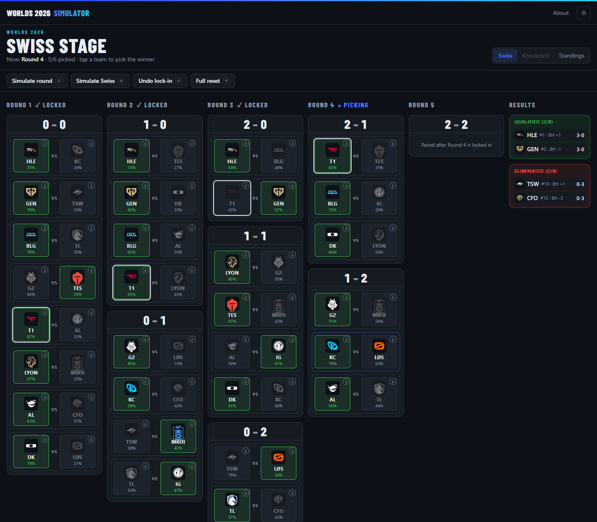
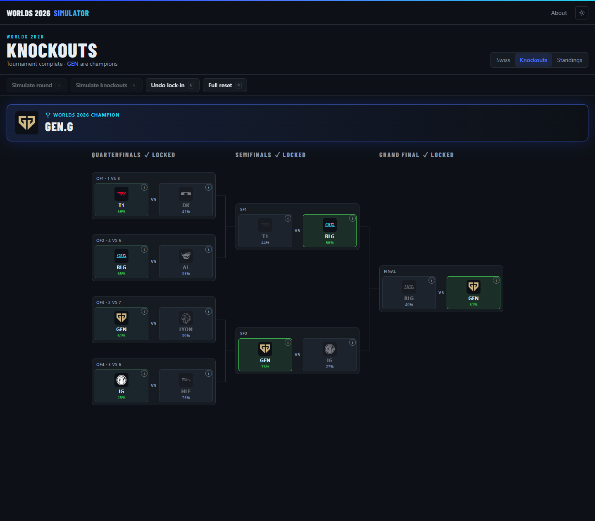
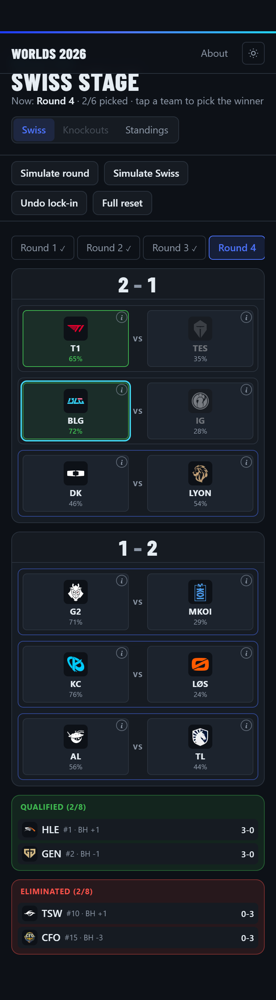

# Worlds 2026 Simulator

A website for playing out the League of Legends **Worlds 2026** main event: the Swiss stage, then the knockout bracket, down to a champion.

You can pick every winner yourself, let the computer simulate matches using odds based on each team's strength, or mix the two. Everything runs in your browser. There is no server, no database and no login, and your run is saved on your own device.



---

## Contents

- [What you can do](#what-you-can-do)
- [Running it](#running-it)
- [How the tournament works](#how-the-tournament-works)
  - [Teams and seeds](#teams-and-seeds)
  - [The Swiss stage](#the-swiss-stage)
  - [Buchholz (BH), explained](#buchholz-bh-explained)
  - [The knockouts](#the-knockouts)
- [How the odds work](#how-the-odds-work)
  - [The optional LCK/LPL bias](#the-optional-lcklpl-bias)
- [Project layout](#project-layout)
- [Changing things](#changing-things)
- [Tests](#tests)
- [Deploying to Vercel](#deploying-to-vercel)

---

## What you can do

| Action | How |
| --- | --- |
| **Pick a winner** | Tap a team. Tap the other team to change your pick, or tap the same team again to clear it. |
| **Lock in a round** | Once every match in the round has a pick, a **Lock in** button appears. Locking in creates the next round's matchups. |
| **Simulate round** (`S`) | Fills every match you haven't picked, then locks the round in. Your own picks are kept. |
| **Simulate Swiss** (`A`) | Plays out the rest of the Swiss stage (up to the end of round 5). |
| **Simulate knockouts** (`A` on the bracket) | Plays out the rest of the bracket until there is a champion. |
| **Undo lock-in** (`U`) | Reopens the last locked round with your picks still selected, and removes everything after it. You can keep undoing back to round 1. |
| **Full reset** (`R`) | Starts again from the round 1 draw. |
| **Team info** | Hover or tap the small **(i)** on a team for its seed, Buchholz, Riot points and league. |
| **Follow a team** | Hover over a team to highlight it in every round. |

Every time you simulate, the site asks whether to use **normal odds** or the **LCK/LPL bias** (explained [below](#the-optional-lcklpl-bias)). In that prompt, `N` picks normal odds, `B` picks the bias and `Esc` cancels.

There are three views:

- **Swiss**: one column per round, with matches grouped by record (2 – 0, 1 – 1, …), plus **Qualified** and **Eliminated** lists.
- **Knockouts**: the 8-team bracket (quarterfinals, semifinals, grand final) and a champion banner at the end. It opens once the Swiss stage is finished.
- **Standings**: the live Swiss table, showing each team's record, Buchholz and result in every round.

The site has a dark mode (the default) and a light mode, and it works on phones. On a narrow screen you see one Swiss round at a time, and the bracket scrolls sideways.

| Finished bracket | On a phone |
| --- | --- |
|  |  |

---

## Running it

You need **Node.js 20 or newer**.

```bash
npm install      # install dependencies (first time only)
npm run dev      # start the site at http://localhost:3000
```

Other commands:

```bash
npm test         # run the automated tests
npm run build    # build the production version (this also type-checks)
npm start        # serve the production build
```

> **Windows tip:** if PowerShell says `npm is not recognized`, Node was probably installed after your terminal (or VS Code) was opened. Close every VS Code window and reopen it, then try again.

---

## How the tournament works

### Teams and seeds

The 16 teams and their seeds are fixed and can't be changed in the site. Seeds come from **Riot's Global Power Ranking** published before Worlds. Teams with the same points were ordered by win rate.

| Seed | Team | League | Riot points |
| --- | --- | --- | --- |
| 1 | HLE – Hanwha Life Esports | LCK | 1540 |
| 2 | GEN – Gen.G | LCK | 1519 |
| 3 | BLG – Bilibili Gaming | LPL | 1513 |
| 4 | G2 – G2 Esports | LEC | 1475 |
| 5 | T1 – T1 | LCK | 1471 |
| 6 | LYON – LYON | LCS | 1438 |
| 7 | AL – Anyone's Legend | LPL | 1409 |
| 8 | DK – Dplus Kia | LCK | 1409 |
| 9 | KC – Karmine Corp | LEC | 1375 |
| 10 | TSW – Team Secret Whales | LCP | 1372 |
| 11 | TL – Team Liquid | LCS | 1368 |
| 12 | TES – Top Esports | LPL | 1364 |
| 13 | IG – Invictus Gaming | LPL | 1348 |
| 14 | MKOI – Movistar KOI | LEC | 1317 |
| 15 | CFO – CTBC Flying Oyster | LCP | 1317 |
| 16 | LØS – LØS | CBLOL | 1174 |

### The Swiss stage

- Every team starts at **0 – 0**.
- **3 wins** and a team qualifies for the knockouts. **3 losses** and it's eliminated.
- There are at most **5 rounds**, and **8 teams** qualify.

**Round 1** is fixed by seed: 1 plays 9, 2 plays 10, and so on down to 8 vs 16.
Teams from the same league may not meet in round 1. If two would, the team from seeds 9–16 swaps places with the nearest other team in seeds 9–16. It tries the next seed number first (for example 10 → 11), then the previous one (10 → 9), then two away in each direction, and so on, until no pair clashes. (With the current seeds no swap is needed.)

**Rounds 2 to 5** are paired like this:

1. Put teams into groups by record, so 2 – 0 teams play 2 – 0 teams, 1 – 1 teams play 1 – 1 teams, and so on.
2. Inside each group, sort teams by **Buchholz** (highest first), then by **seed** (best first).
3. Pair the **top** team with the **bottom** team, the second with the second-to-last, and so on.
4. **No rematches.** If the natural opponent has already been played, the top team takes the lowest-sorted team it *hasn't* played yet. If that would leave the rest of the group impossible to pair, it tries the next option.

The league rule only applies to round 1.

**Final Swiss standings** are ordered by wins (most first), then losses (fewest first), then Buchholz (highest first), then seed (best first).

### Buchholz (BH), explained

Buchholz measures **how tough a team's opponents have been so far**.

> **BH = for every opponent you've played, add up (their wins − their losses).**

For example, suppose a team has played three opponents whose current records are 3 – 0, 1 – 2 and 2 – 1:

```
(3 − 0) + (1 − 2) + (2 − 1) = 3 + (−1) + 1 = +3
```

A high BH means you've faced strong teams, so you're ranked higher within your record group. BH changes every round as your past opponents keep winning or losing.

In each Swiss round, the BH in a team's info popover is the value **at the moment that round was paired**, so you can see why the matchups came out as they did. The Standings tab and the Qualified/Eliminated lists show the **current** BH.

### The knockouts

The 8 qualifiers are seeded **1 to 8 in final Swiss standings order**. The bracket is fixed by seed:

| Match | Teams |
| --- | --- |
| QF1 | Seed 1 vs Seed 8 |
| QF2 | Seed 4 vs Seed 5 |
| QF3 | Seed 2 vs Seed 7 |
| QF4 | Seed 3 vs Seed 6 |
| Semifinal 1 | Winner QF1 vs Winner QF2 |
| Semifinal 2 | Winner QF3 vs Winner QF4 |
| Grand Final | Winner SF1 vs Winner SF2 |

Teams that met in the Swiss stage can meet again here.

---

## How the odds work

Each team's chance of winning a match comes from its **Riot points**, using the same formula chess uses for Elo ratings:

```
P(A beats B) = 1 / (1 + 10 ^ ((points_B − points_A) / 400))
```

In plain words: **the bigger the gap in points, the bigger the favourite's chance.**

| Match | Gap | Favourite's chance |
| --- | --- | --- |
| AL (1409) vs DK (1409) | 0 | 50% |
| HLE (1540) vs GEN (1519) | 21 | 53% |
| G2 (1475) vs KC (1375) | 100 | 64% |
| T1 (1471) vs IG (1348) | 123 | 67% |
| DK (1409) vs LØS (1174) | 235 | 79% |

Some things to know:

- The chance is for the **whole series**, not for single games.
- No match is ever 0% or 100%. The underdog always has a chance.
- Points **never change** during a run. Winning doesn't make a team stronger in later rounds.
- The percentage under each team is just a guide. You can always pick the underdog.

When you simulate, the site effectively rolls a die weighted by these odds for each unpicked match.

### The optional LCK/LPL bias

When you simulate, you can choose **LCK/LPL bias** instead of normal odds. With the bias on:

- An **LCK or LPL team gets +300 points** when it plays a team from **any other league**. This applies to that one match only.
- There's **no boost** for LCK vs LPL, for two teams from the same league, or for two teams from other leagues.

For example, Top Esports (LPL, 1364) normally has a **35%** chance against G2 (LEC, 1475). With the bias it plays at 1664 points, so its chance becomes **75%**. Upsets are still possible.

| Match | Normal odds | With bias |
| --- | --- | --- |
| TES vs G2 | 35% | 75% |
| HLE vs KC | 72% | 94% |
| DK vs LØS | 79% | 96% |
| T1 vs IG (LCK vs LPL) | 67% | 67% (no boost) |

The percentages shown on the match cards are **always the normal odds**. The bias only comes into play at the moment you simulate with it.

---

## Project layout

The tournament logic is kept separate from the website code, so you can read, test and change the rules without touching any of the page code.

```
data/
  teams.ts          The 16 teams, seeds, leagues and Riot points
  logos.ts          Maps each team tag to its logo image
  images/           Team logo files

lib/                Pure logic, no website code
  engine.ts         Swiss pairing, Buchholz, standings, knockout seeding
  odds.ts           Win chances, the LCK/LPL bias, random draws
  config.ts         Tunable settings (the bias size)
  tournament.ts     A run as a whole: pick, lock in, undo, simulate, save/restore
  board.ts          Helpers that arrange data for the Swiss board

components/         The pieces of the page
  Simulator.tsx     Main page: buttons, views, keyboard shortcuts, saving
  SwissBoard.tsx    Swiss rounds, record groups, Qualified/Eliminated lists
  Bracket.tsx       Knockout bracket and champion banner
  StandingsTable.tsx  Live Swiss table
  MatchCard.tsx     One match: two team tiles, odds, (i) info popover
  OddsPrompt.tsx    The "normal odds or LCK/LPL bias?" prompt
  TeamLogo.tsx, ThemeToggle.tsx, HoverContext.tsx

app/
  page.tsx          The simulator page (/)
  about/page.tsx    The About page (/about)
  layout.tsx        Header, fonts, theme
  globals.css       Colours for dark and light mode

tests/              Automated tests (Vitest)
screenshots/        Screenshots used in this README
```

**How a run is stored:** a run is a list of 8 *stages* (Swiss rounds 1–5, then quarterfinals, semifinals and grand final) plus a count of how many are locked. Locking a stage asks the engine to build the next one from the results so far. Undo just lowers the count and drops the stages after it. The run is saved in your browser's `localStorage`, so a refresh keeps it. When it's loaded back, every stage is rebuilt from the saved picks, so broken or outdated saved data can't confuse the engine.

---

## Changing things

| I want to… | Change this |
| --- | --- |
| Make the LCK/LPL bias bigger or smaller | `LCK_LPL_BONUS` in [lib/config.ts](lib/config.ts) |
| Change which leagues get the bias | `BONUS_LEAGUES` in [lib/config.ts](lib/config.ts) |
| Update teams, seeds or points | [data/teams.ts](data/teams.ts) (and the logo map in [data/logos.ts](data/logos.ts) if a tag changes) |
| Change the colours | The variables at the top of [app/globals.css](app/globals.css) (one block for dark, one for light) |

If you change teams or points, run `npm test`. Some tests check the exact matchups and percentages for the current data, and those expected numbers will need updating too.

---

## Tests

```bash
npm test
```

The tests cover the rules and the maths, not the visuals:

- **A full pairing fixture.** Given a fixed set of winners, every round's matchups, the final playoff seeds, the final Buchholz values and the quarterfinals must come out exactly as expected.
- **Round 1 league rule.** No same-league pairs, and the swap order (+1, −1, +2, …) works when a clash is forced.
- **500 random tournaments.** No same-league pairs in round 1, no rematches in the Swiss stage, teams only ever play teams with the same record, every team plays until it has 3 wins or 3 losses, and exactly 8 qualify.
- **Odds.** The exact percentages for normal and bias matchups, plus a check that 100,000 simulated TES vs G2 matches (with bias) land between 74% and 76% for TES.
- **The run itself.** Picking, locking in, undo, keeping user picks when simulating, Simulate Swiss stopping after round 5, and restoring saved runs.

Randomness goes through a small interface, so tests can use a seeded generator and get the same "random" results every time.

---

## Deploying to Vercel

The site is fully static, so it deploys with Vercel's default settings:

1. Push the project to a GitHub repository.
2. In Vercel, choose **Add New → Project** and import the repository.
3. Leave every setting at its default and click **Deploy**.

No environment variables are needed.

---

*Team names and logos belong to their respective organisations. This is an unofficial fan project and isn't affiliated with Riot Games.*
